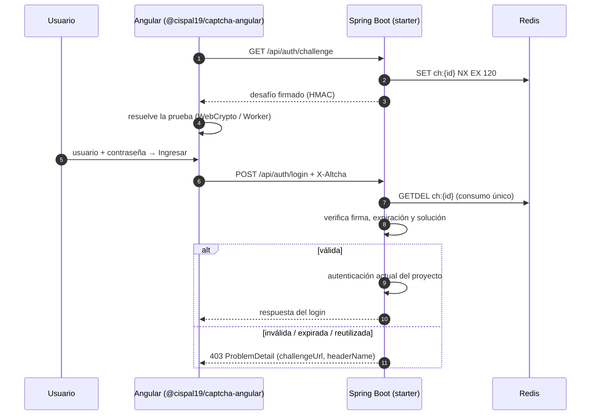

# Librería CAPTCHA reutilizable (ALTCHA · Spring Boot · Angular)

Protección anti-bot autoalojada basada en **ALTCHA Proof-of-Work v2**. Se entrega como dos
componentes versionados por separado:

| Componente | Ruta | Uso |
|---|---|---|
| `captcha-spring-boot-starter` (Spring Boot 4.1, Java 21) | [`backend/captcha-spring-boot-starter`](backend/captcha-spring-boot-starter/README.md) | Emite desafíos, verifica la solución antes de autenticar y limita intentos |
| `@cispal19/captcha-angular` (Angular 21) | [`frontend/projects/captcha-angular`](frontend/projects/captcha-angular/README.md) | Resuelve en segundo plano y adjunta la solución; modo casilla o invisible |

## Cómo funciona



- Fallos por IP y por usuario: con 5 fallos (configurable) se bloquea 5 minutos y se responde
  429 con `Retry-After`.
- Costo adaptativo: cada fallo reciente de la IP duplica el costo del desafío siguiente.
- La clave HMAC se lee de una variable de entorno (por ejemplo, desde un Secret de Kubernetes).

## Integrar en menos de 2 horas

1. **Backend**: agregue la dependencia del starter y configure:

   ```properties
   security.altcha.hmac-key=${ALTCHA_HMAC_KEY}
   spring.data.redis.host=${REDIS_HOST}   # reutiliza el Redis del proyecto
   ```

   Si usa `DaoAuthenticationProvider`, agregue `provider.setPreAuthenticationChecks(blockedLoginChecker)`.
2. **Frontend**: agregue
   `provideHttpClient(withInterceptors([captchaInterceptor]))`, `provideCaptcha({...})` y
   `<captcha-checkbox formControlName="captcha" />` (o `<captcha-notice />` en modo invisible).
3. Genere la clave con `openssl rand -base64 48`, cárguela en el Secret y despliegue.

Detalles en los README de cada componente y en [`docs/contracts/`](docs/contracts/).

> **¿Eres un agente de IA integrando esta librería en otro proyecto?** Sigue
> [`INTEGRATION.md`](INTEGRATION.md) paso a paso.

## Desarrollo

```bash
docker compose up -d redis
export ALTCHA_HMAC_KEY="$(openssl rand -base64 48)" SAMPLE_USER_PASSWORD="$(openssl rand -hex 12)"

mvn -f backend/pom.xml verify                       # pruebas, cobertura, formato, Checkstyle, ArchUnit
mvn -f backend/pom.xml -pl captcha-sample-app spring-boot:run

cd frontend && npm ci
npm run test:ci && npm run lint && npm run build:lib
npm run start:sample                                # http://localhost:4200 (usuario demo)
npm run e2e                                         # Playwright (levanta backend y frontend)
```

## Paquetes publicados

| Componente | Registro | Coordenadas |
|---|---|---|
| Starter Spring Boot | Maven Central | `io.github.cispal19:captcha-spring-boot-starter` |
| Librería Angular | npmjs.com | `@cispal19/captcha-angular` |

Publicación: un tag `starter-vX.Y.Z` publica el starter y un tag `angular-vX.Y.Z` publica la
librería Angular (ver `.github/workflows/ci.yml`).

## Licencia

[Apache License 2.0](LICENSE).
